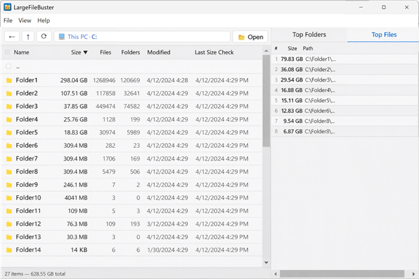

# LargeFileBuster

**Interactive disk-space explorer for Windows.**

Hard drives fill up. The built-in file explorer doesn't help much — you end up clicking through folder after folder, checking sizes one by one, and nothing is remembered for next time. LargeFileBuster fixes that: it scans your drives, ranks every folder and file by size, persists the results in a local database, and lets you navigate straight to the biggest space hogs and bust them right away. Not less, not more.




---

## Features

- **Drive & folder browser** — navigate your filesystem with breadcrumbs, back button, and double-click drill-down
- **Deep & shallow scanning** — full recursive scan or quick single-level overview
- **SQLite storage** — scan results persisted in a local `lfb.sqlite` database (via [sql.js](https://github.com/sql-js/sql.js) / WebAssembly)
- **Top-lists sidebar** — tabbed panels ranking the largest folders and files with sortable columns
- **Context-menu actions** — "Continue deep scan…" with date picker to skip recently-scanned subtrees
- **Real-time scan progress** — live item count and current-path updates during scans
- **Reset database** — via File menu, with confirmation dialog
- **Open in Explorer** — right-click any item to reveal it in Windows Explorer

## Quick start

### Prerequisites

- [Node.js](https://nodejs.org/) ≥ 18
- npm ≥ 9

### Install & run

```bash
npm install
npm run dev
```

This builds the Electron main process, starts the Vite dev server on `http://localhost:5173`, and launches the Electron window with hot-reload.

### Build for production

```bash
npm run build          # compile main + renderer
npm run dist:win       # package as Windows NSIS installer (bin/)
```

### Run tests

```bash
npx playwright install --with-deps   # first time only
npm test                             # builds, then runs the Playwright tests
```

The suite has two parts: `test/smoke.spec.ts` drives the UI, `test/security.spec.ts` checks that the protections described under [Security](#security) are in place.

After packaging, `npm run smoke:packaged` starts the packaged app from `bin/` and checks it the same way (fuses, origin, database location, renderer lockdown).

## Project structure

```
src/
├── main/            # Electron main process
│   ├── main.ts      # app entry, window & menu creation
│   ├── security.ts  # app:// protocol, CSP, navigation/permission lock-down, IPC sender check
│   ├── ipc.ts       # IPC handlers (children, top, scan, list-dir, …)
│   ├── validate.ts  # validation of everything that arrives over IPC
│   ├── db.ts        # sql.js database layer (open, query, upsert, reset)
│   └── scanner.ts   # filesystem scanner (shallow & async full)
├── preload/
│   └── preload.ts   # context-bridge API exposed as window.lfb
├── renderer/
│   ├── index.html   # HTML shell
│   ├── main.tsx     # React entry point
│   └── ui/App.tsx   # single-file React UI (869 LOC)
└── shared/
    └── types.ts     # shared TypeScript interfaces (ItemRecord, requests, …)
test/
├── smoke.spec.ts    # Playwright end-to-end tests of the UI
└── security.spec.ts # Playwright security regression tests
scripts/
└── smoke-packaged.mjs  # checks the packaged app in bin/
```

## Scripts

| Script | Description |
|--------|-------------|
| `npm run dev` | Dev mode with hot-reload (Vite + Electron) |
| `npm run build` | Production build (renderer via Vite, main via tsc) |
| `npm run build:main` | Compile main process only |
| `npm run build:renderer` | Bundle renderer only |
| `npm run lint` | ESLint check on `src/` |
| `npm run typecheck` | TypeScript type checking (no emit) |
| `npm test` | Build + Playwright tests (UI and security) |
| `npm run smoke:packaged` | Check the packaged app in `bin/` (run after packaging) |
| `npm run dist:win` | Package Windows installer |

## Tech stack

| Component | Technology |
|-----------|-----------|
| Desktop framework | [Electron 45](https://www.electronjs.org/) |
| UI | [React 18](https://react.dev/) |
| Build (renderer) | [Vite 6](https://vitejs.dev/) |
| Build (main) | TypeScript compiler |
| Database | [sql.js 1.15](https://github.com/sql-js/sql.js) (SQLite via WebAssembly) |
| Testing | [Playwright](https://playwright.dev/) (Electron integration) |
| Packaging | [electron-builder](https://www.electron.build/) |

## Security

LargeFileBuster reads your whole file system, so the app is locked down to its own code:

- The UI runs in a sandboxed renderer with context isolation and no Node.js access. It is served from a private `app://` origin with a strict Content-Security-Policy.
- The window cannot navigate anywhere else or open other windows, all permission requests are denied, and network requests are blocked. The app works offline.
- The main process only answers IPC calls from its own UI and validates every argument.
- Release builds have the Electron fuses set: no `ELECTRON_RUN_AS_NODE`, no `NODE_OPTIONS`, no `--inspect`, and the app code is only loaded from the integrity-checked `app.asar`.

Details, known limitations and how to report a vulnerability: [SECURITY.md](SECURITY.md).

## License

Licensed under the [European Union Public Licence (EUPL) v1.2](LICENSE).

## Contributors

Created by **Stanislaw Koltschin** — [stan.the.maker@koltschin.net](mailto:stan.the.maker@koltschin.net)

Contributions welcome! Feel free to open issues or pull requests.
